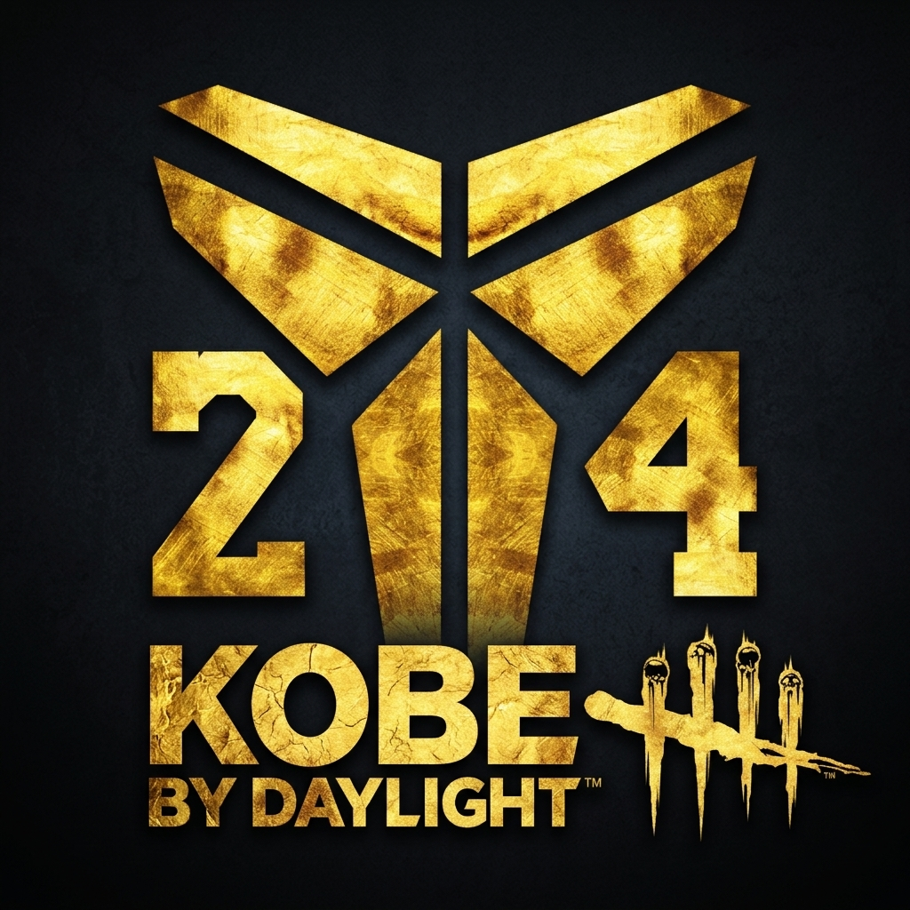

<p align="center"></p>

# Kobe by Daylight

A Kobe Bryant themed overlay for **Dead by Daylight**, for Windows and Linux.
Created by LT and Claude, based on ering6666's Dead by Daylight edits.

When you spawn into a trial it:

- plays your music for the whole match,
- shows a stopwatch in the top-left corner that jerks on the beat of the music,
- pops up a random Kobe with a random line in a speech bubble, with "What can I say",
- plays random Kobe sounds now and then,
- plays "Man" when you press Space (vaulting a window, dropping a pallet).

The app lives in the system tray. The tray icon shows the state with a coloured dot:
red = game not running, yellow = in the lobby, green = in a match.

## Download

Get the latest build from **[Releases](https://github.com/rLTplay3r/KobeByDaylight/releases)**.
Each release is a single file with everything built in, music included.

**Windows (10 version 1903 or newer, or 11)**: download `DBD-Kobe-Overlay.exe` and run it.
SmartScreen warns about unsigned apps: click **More info**, then **Run anyway**.

**Linux**: download `DBD-Kobe-Overlay`, then:

```sh
chmod +x DBD-Kobe-Overlay
sudo dnf install xcb-util-cursor     # Fedora; Debian/Ubuntu: sudo apt install libxcb-cursor0
./DBD-Kobe-Overlay
```

The Linux release is built on a recent Fedora. If it doesn't start on an older distribution,
[build it yourself](#build-from-source).

## Use

1. Start the app. It goes to the tray; click the tray icon to open the panel.
2. In Dead by Daylight set **Display Mode** to **Borderless** or **Windowed**. Exclusive
   fullscreen hides every overlay, including this one.
3. Play. Spawning into a trial is detected automatically; the overlay stops about 25 seconds
   after the match ends.

**F8** starts or ends a match by hand at any time, if the detection ever misses one.

The panel lets you switch every effect on or off, set the music and sound volume, how often
Kobe and the random sounds appear, and the size of the timer, Kobe and the speech bubble
(**Edit scale** shows them on screen as a preview while you change them).

### How the match is detected

Like Fog Companion, the app takes a screenshot of the bottom-right corner of the game window
twice a second and looks for the in-match perk HUD: four perks arranged in a diamond. The lobby
and the scoreboard show perks in a row, so the diamond means you're in a trial. It looks at the
shape, not at specific perks, so it works as killer and as survivor, with any loadout, at any
resolution (16:9, 21:9, 4:3) and HUD scale.

### Anti-cheat

The app never opens the game process, reads its memory, injects anything or sends input:

- **Game running:** reads the names in the OS process list. Steam, Epic (also through Heroic)
  and the Microsoft Store versions are recognised, natively or under Proton/Wine.
- **Match detection:** screenshots of the game window, the same as OBS or Discord take.
- **Keys (Space, F8):** read-only. On Windows the key state is polled (no keyboard hook);
  on Linux it goes through the X server or evdev.
- **Overlay:** a separate transparent window that mouse clicks pass through.

## Customize

Put any of these next to the executable (or edit them in the source) to change the content:

| File / folder | What it does |
|---|---|
| `Music/` | Music for matches. Every audio file plays, shuffled and looped. |
| `Sounds/` | "MAN" plays on Space, "What Can I Say" with every Kobe pop-up. Every other sound in the folder plays at random moments. |
| `kobe-sprites/` | Kobe cutouts (transparent PNG). Each pop-up picks one at random; the bubble attaches to the head automatically. |
| `kobe_texts.txt` | Lines for the speech bubble, one per line. |
| `speechbuble.png` | The speech bubble image. |

Settings are saved in `~/.config/dbd-kobe-overlay/settings.json` on Linux and
`%LOCALAPPDATA%\dbd-kobe-overlay\settings.json` on Windows.

## Build from source

The source code does **not** include music (copyright). Put your own `.mp3` (or `.ogg`,
`.wav`, `.flac`, `.m4a`) files into `Music/` before building, or the app runs without music.

```sh
git clone https://github.com/rLTplay3r/KobeByDaylight.git
cd KobeByDaylight
```

### On Linux: Linux and Windows executables (KBD-Builder)

The builder is a small app that builds the Linux executable natively and the Windows `.exe`
through Wine, both on Linux.

1. Install what it needs once:
   - Fedora: `sudo dnf install python3 wine xcb-util-cursor`
   - Debian/Ubuntu: `sudo apt install python3 python3-venv wine libxcb-cursor0`

   Wine is only needed for the Windows `.exe`.
2. Start the builder: `./build-tool.sh`. The first start installs its own Python environment
   into `build/venv`, which takes a few minutes.
3. Tick **Linux executable** and/or **Windows .exe**, then click **BUILD**. The first Windows
   build also downloads Windows Python into a separate Wine prefix (`build/win/pfx`, about 3 GB).
4. The executables appear in `dist/`. **OPEN DIST FOLDER** opens it.

Optional:

- `./build-tool.sh --build builder` turns the builder itself into a standalone app, `KBD-Builder`,
  that you can double-click. **ADD TO APP MENU** in the builder adds it to the application menu.
- Build from a terminal: `./build-tool.sh --build linux windows`.
- **+1** and the "What changed" box raise the version and add the notes to `CHANGELOG.md`.

The Windows `.exe` built through Wine can't be test-run in Wine (Qt needs the ICU libraries
that come with Windows 10/11), so try it on a Windows PC.

### On Windows: the Windows executable

1. Install [Python 3.12](https://www.python.org/downloads/) (tick **Add python.exe to PATH**).
2. Double-click `packaging\build.bat`.
3. The executable is `dist\DBD-Kobe-Overlay.exe`.

### Run without building

```sh
python3 -m venv .venv
.venv/bin/pip install -r requirements.txt
.venv/bin/pip install --no-deps -r requirements-nodeps.txt   # Linux only
.venv/bin/python run.py --simulate    # 35 s fake match, no game needed
.venv/bin/python run.py               # normal mode
```

On Windows use `.venv\Scripts\pip` and `.venv\Scripts\python`.

## Known limits

- Space is also the skill-check key, so "Man" can play on skill checks (there is a cooldown).
- Linux: match detection needs the game running through XWayland, which is the Proton default.
  It doesn't work with `PROTON_ENABLE_WAYLAND=1`.
- Linux: for the most reliable Space detection install `evdev` (`pip install evdev`, needs a C
  compiler) and add your user to the `input` group.
- If the panel says "HUD: not visible" while you're in a match, click **Save HUD capture** and
  open an issue with the image from the settings folder's `debug/` subfolder.

## License and credits

The code is under the [MIT License](LICENSE). The images, sounds and the Oswald font keep their
own owners and licenses:

- Oswald font by The Oswald Project Authors, [SIL Open Font License 1.1](fonts/OFL-Oswald.txt).
- Idea and style based on ering6666's Dead by Daylight edits.

Kobe by Daylight is a fan project. It isn't affiliated with or endorsed by Behaviour Interactive,
Dead by Daylight or the Kobe Bryant estate. Dead by Daylight is a trademark of Behaviour Interactive.

Version history: [CHANGELOG.md](CHANGELOG.md).
